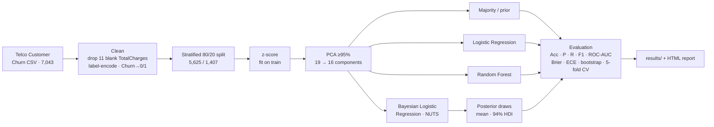

# Bayesian Churn Prediction

**Customer churn prediction with uncertainty quantification: Bayesian logistic regression sampled with Hamiltonian Monte Carlo (NUTS, PyMC), PCA, classical baselines and an automated HTML report.**

Traditional classifiers say *"this customer will churn with 70% probability"*. This project says *"70%, and the 94% credible interval is 66–74%"*. It learns a full posterior distribution over every model parameter, so retention teams can make risk-aware decisions.

All results come from the **real IBM Telco Customer Churn dataset** (7,043 customers). Synthetic data is used only for a clearly labelled sampler sanity check. Full write-up: **[REPORT.md](REPORT.md)**. Complete beginner-to-technical guide: **[docs/Project_Guide.pdf](docs/Project_Guide.pdf)**.

---

## Highlights

- **Bayesian logistic regression** trained with **HMC / NUTS** (PyMC 5): 4 chains × 1,000 draws, max R-hat 1.003, 0 divergences
- **PCA** compresses the 19 encoded features into 16 components that keep **97.0%** of the variance
- Benchmarked against **majority-class / base-rate baselines**, **logistic regression** and **random forest**, plus no-PCA references and an **interpretable one-hot Bayesian model**
- **Uncertainty quantification**: posterior mean and 94% HDI for every customer, selective-prediction analysis, posterior predictive checks
- **Diagnostics** via ArviZ: R-hat, bulk/tail ESS, divergences, E-BFMI, trace, rank, energy, forest and posterior-correlation plots
- **Honest evaluation**: hold-out test set with paired bootstrap CIs, **stratified 5-fold CV**, calibration (Brier, ECE, reliability), prior sensitivity, PSIS-LOO, a training-set-size study
- **Automated HTML report** (`results/main/report.html`)

## Pipeline



## Method

**1. Preprocessing.** The 11 rows with a blank `TotalCharges` are dropped (7,043 → 7,032 customers). `customerID` is dropped, categorical columns are label-encoded (19 features), and `Churn` is mapped to {No: 0, Yes: 1}. A stratified 80/20 split gives 5,625 training and 1,407 test customers. Features are standardised, z = (x − μ)/σ, using training statistics only.

**2. Dimensionality reduction.** PCA keeps the smallest number of components that explains ≥ 95% of the variance: **16 components, 97.0%**.

**3. Bayesian model.**

$$
\beta_0,\ \beta_j \sim \mathcal{N}(0, 1), \qquad p_i = \sigma\!\left(\beta_0 + \sum_j \beta_j z_{ij}\right), \qquad y_i \sim \text{Bernoulli}(p_i)
$$

The posterior $p(\beta \mid D) \propto p(D \mid \beta)\,p(\beta)$ is sampled with **Hamiltonian Monte Carlo** (No-U-Turn Sampler). HMC treats the parameters as a particle moving on the negative log-posterior surface:

$$
H(\beta, p) = U(\beta) + K(p), \qquad U(\beta) = -\log p(\beta \mid D), \quad K(p) = \tfrac{1}{2} p^\top M^{-1} p
$$

The model structure (features → churn) is fixed, so only **parameter learning** is needed: we learn how strongly each component affects churn.

**4. Uncertainty.** Each test customer gets a predictive distribution from 4,000 posterior draws, $p_*^{(s)} = \sigma(\beta_0^{(s)} + \beta^{(s)\top} z_*)$. We report its mean and its 94% highest-density interval (HDI).

## Results (real data, reproduced in this repository)

Hold-out test set (1,407 customers, threshold 0.5). Full tables with bootstrap CIs are in [REPORT.md](REPORT.md).

| Model | Accuracy | Precision | Recall | F1 | ROC-AUC | Brier |
|---|---|---|---|---|---|---|
| Majority class ("nobody churns") | 0.7342 | 0.0000 | 0.0000 | 0.0000 | 0.5000 | 0.2658 |
| Logistic Regression (PCA) | 0.7733 | 0.5868 | 0.4973 | 0.5384 | 0.8206 | 0.1464 |
| Random Forest (PCA) | 0.7697 | 0.5822 | 0.4733 | 0.5221 | 0.7986 | 0.1570 |
| **Bayesian HMC (PCA)** | **0.7733** | **0.5868** | **0.4973** | **0.5384** | **0.8206** | **0.1463** |
| Logistic Regression (all features, no PCA) | 0.7939 | 0.6243 | 0.5642 | 0.5927 | 0.8345 | 0.1410 |
| Bayesian HMC (one-hot features, no PCA) | 0.8038 | 0.6476 | 0.5749 | 0.6091 | 0.8356 | 0.1402 |

Stratified 5-fold cross-validation (all 7,032 customers, mean ± SD):

| Model | Accuracy | F1 | ROC-AUC | Brier |
|---|---|---|---|---|
| Logistic Regression (PCA) | 0.7952 ± 0.0086 | 0.5737 ± 0.0166 | 0.8343 ± 0.0033 | 0.1400 ± 0.0016 |
| Random Forest (PCA) | 0.7770 ± 0.0098 | 0.5093 ± 0.0189 | 0.7983 ± 0.0062 | 0.1548 ± 0.0037 |
| **Bayesian HMC (PCA)** | **0.7955 ± 0.0085** | **0.5743 ± 0.0161** | **0.8343 ± 0.0032** | **0.1400 ± 0.0016** |
| Bayesian HMC (one-hot, no PCA) | 0.8046 ± 0.0065 | 0.6006 ± 0.0120 | 0.8451 ± 0.0030 | 0.1356 ± 0.0010 |

**What this means**

- The Bayesian model is far above chance (AUC 0.82–0.83 vs 0.5) and well calibrated (ECE ≈ 0.02).
- It **matches** L2 logistic regression almost exactly. With an N(0,1) prior the MAP *is* L2-penalised LR, and 5,625 customers overwhelm the prior. The Bayesian value is the **uncertainty**, not extra accuracy.
- The uncertainty is informative. Accuracy is **92.2%** on the most confident half of test customers and **62.4%** on the least confident half. The mean 94% HDI width is 0.077 (≈ ±3.8 percentage points). With small training sets (50–100 customers) the prior keeps the Bayesian model sensible (log-loss ≈ 0.53–0.55), while maximum-likelihood LR over-fits (log-loss up to 6.7). From about 500 customers on the two agree (see REPORT §8.6).
- PCA slightly *hurts*. The best model is the Bayesian LR on one-hot features, which also gives readable coefficients: tenure and long contracts lower churn; fibre optic and electronic-check payment raise it.

**Learned posterior (corrected pipeline, first parameters):**

| Parameter | Mean | ± SD | 94% HDI |
|---|---|---|---|
| Intercept β₀ | −1.6207 | 0.0502 | [−1.716, −1.529] |
| PC1 β₁ | −0.4896 | 0.0228 | [−0.532, −0.447] |
| PC2 β₂ | 0.8528 | 0.0318 | [0.794, 0.911] |
| PC3 β₃ | 0.1173 | 0.0330 | [0.054, 0.179] |
| PC4 β₄ | 0.1678 | 0.0341 | [0.107, 0.234] |
| PC5 β₅ | −0.2829 | 0.0344 | [−0.345, −0.217] |

### Results reported in the original project

> These are the numbers from the original README, kept unchanged for reference. They were **not** produced by this rebuild.

| Model | Accuracy | Precision | Recall | F1 | ROC-AUC |
|---|---|---|---|---|---|
| Logistic Regression | 0.7939 | 0.6265 | 0.5561 | 0.5892 | 0.8342 |
| Random Forest | 0.7854 | 0.6216 | 0.4920 | 0.5493 | 0.8238 |
| Bayesian HMC | 0.7704 | 0.5794 | 0.4973 | 0.5353 | 0.8204 |

Original setup: "20 features → 17 PCA components (97.2% variance)". Posterior: β₀ −1.6266 ± 0.0502, PC1 −0.4907, PC2 0.8556, PC3 0.1181, PC4 0.1733, PC5 −0.2820.

**Why they differ:** the original run kept `customerID` as a label-encoded feature. That is the 20th "feature", and it forces a 17th PCA component. Re-running with `--legacy-keep-id` reproduces 20 features / 17 components / 97.2% and the Bayesian row (0.7711 / 0.5812 / 0.4973 / 0.5360 / **0.8204**), and gives posterior means matching the README to 2–3 decimals (β₀ −1.6213, PC1 −0.4893, PC2 0.8529, PC5 −0.2830). The README's LR row matches LR on all features *without* PCA (AUC 0.8345). An ID carries no information, so the corrected pipeline drops it; the effect on accuracy is negligible. Details: [REPORT.md §8.4](REPORT.md).

## Project Structure

```
Bayesian-Churn-Prediction/
├── data/                          # downloaded CSV goes here (not committed)
├── scripts/
│   ├── download_data.py           # resumable, validated download of the Telco CSV
│   ├── run_cv.py                  # stratified 5-fold CV of every model (resumable per fold)
│   ├── run_prior_sensitivity.py   # prior σ ∈ {0.01, 0.1, 1, 10} + PSIS-LOO comparison
│   ├── run_data_size.py           # learning curves: Bayes vs ≈MLE LR, interval width vs n
│   ├── run_synthetic.py           # SYNTHETIC sanity check: recovery + HDI coverage
│   ├── make_figures.py            # dataset (EDA) figures
│   ├── make_guide_figures.py      # explanatory diagrams for the guide
│   └── run_all_experiments.sh     # reproduces every number in REPORT.md
├── src/
│   ├── data.py                    # loading, cleaning, label / one-hot encoding, synthetic generator
│   ├── features.py                # stratified split, z-score + PCA (fit on train only)
│   ├── models.py                  # baselines, HDI, BayesianLogisticRegression (PyMC NUTS)
│   ├── evaluate.py                # metrics, calibration (ECE), paired bootstrap CIs
│   ├── plots.py                   # all result figures
│   ├── report.py                  # automated HTML report
│   └── main.py                    # end-to-end pipeline
├── tests/test_pipeline.py         # pytest (16 tests)
├── results/                       # metrics.json, tables, predictions, figures, models, report.html
├── docs/Project_Guide.pdf         # complete guide (simple + technical), code walkthrough, viva Q&A
├── REPORT.md                      # full project report
└── requirements.txt
```

## Getting Started

```bash
pip install -r requirements.txt
python scripts/download_data.py          # -> data/WA_Fn-UseC_-Telco-Customer-Churn.csv (970 KB)
python src/main.py                       # -> results/main/ (metrics, figures, models, report.html), ~2 min
```

Reproduce everything (CV, prior sensitivity, data-size study, synthetic check, tests, about 45 min on 4 cores; each step resumes if interrupted):

```bash
bash scripts/run_all_experiments.sh
python scripts/make_guide_figures.py && python docs/build_guide_pdf.py   # rebuild the PDF guide
```

Reproduce the original README's (customerID) setting:

```bash
python src/main.py --legacy-keep-id --skip-full --out results/legacy_with_customerID
```

The dataset is the IBM sample published on Kaggle as [`blastchar/telco-customer-churn`](https://www.kaggle.com/datasets/blastchar/telco-customer-churn). The download script fetches the identical file from IBM's public GitHub mirror, so no Kaggle login is needed.

## Tech Stack

Python · PyMC · PyTensor · ArviZ · scikit-learn · pandas · NumPy · Matplotlib · ReportLab · pytest

## References

- C. M. Bishop, *Pattern Recognition and Machine Learning*, Springer, 2006.
- K. P. Murphy, *Machine Learning: A Probabilistic Perspective*, MIT Press, 2012.
- R. M. Neal, "MCMC Using Hamiltonian Dynamics," *Handbook of Markov Chain Monte Carlo*, CRC Press, 2011.
- M. D. Hoffman & A. Gelman, "The No-U-Turn Sampler," *JMLR* 15, 2014.
- D. Koller & N. Friedman, *Probabilistic Graphical Models*, MIT Press, 2009.
- A. Vehtari et al., "Rank-normalization, folding, and localization: an improved R-hat," *Bayesian Analysis*, 2021.

## Team

Team 12 · Department of Artificial Intelligence, Amrita Vishwa Vidyapeetham, Coimbatore

- Dodla Nithya Sai
- M. Vishnu Vardhan
- P. Sreekar Reddy
- S. Beena Reddy
