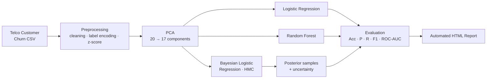

# Bayesian Churn Prediction

**Customer churn prediction with uncertainty quantification using Bayesian inference (Hamiltonian Monte Carlo), PCA, and an automated HTML report.**

Traditional classifiers say *"this customer will churn with 70% probability"*. This project says *"70% ± 5%"* — a full posterior distribution over every model parameter, so retention teams can make risk-aware decisions.

---

## Highlights

- **Bayesian logistic regression** trained with **HMC / NUTS** (PyMC) — posterior distributions instead of point estimates
- **PCA** compresses 20 features into 17 components while retaining **97.2%** of the variance
- Benchmarked against **Logistic Regression** and **Random Forest**
- **Uncertainty quantification**: credible intervals for every prediction
- **MCMC diagnostics** via ArviZ: trace plots, forest plots, parameter correlations, energy plots
- **Automated HTML report** that collects PCA analysis, model comparison and Bayesian insights in one dashboard

## Pipeline



## Method

**1. Preprocessing.** Blank `TotalCharges` rows are dropped (7,043 → 7,032 customers), categorical columns are label-encoded, numerical features are standardised (z = (x − μ) / σ), and `Churn` is mapped to {No: 0, Yes: 1}.

**2. Dimensionality reduction.** PCA keeps the smallest number of components that explains ≥ 95% of the variance. The result is 17 components with 97.2% of the variance retained.

**3. Bayesian model.**

$$
\beta_j \sim \mathcal{N}(0, 1), \qquad p_i = \sigma\!\left(\beta_0 + \sum_j \beta_j z_{ij}\right), \qquad y_i \sim \text{Bernoulli}(p_i)
$$

The posterior is sampled with **Hamiltonian Monte Carlo** (NUTS). HMC treats the parameters as a particle moving on the negative log-posterior surface:

$$
H(\beta, p) = U(\beta) + K(p), \qquad U(\beta) = -\log P(\beta \mid D), \quad K(p) = \tfrac{1}{2} p^\top M^{-1} p
$$

Only **parameter learning** is needed because the model structure (features → churn) is fixed. We only learn how strongly each component affects churn.

**4. Uncertainty.** Each test customer gets a predictive distribution from 2,000 posterior draws. The report shows its mean and its 94% HDI.

## Results

Dataset: **7,032 customers · 20 features · 26.6% churn rate** · 80/20 split (5,625 training samples)

| Model | Accuracy | Precision | Recall | F1 | ROC-AUC |
|---|---|---|---|---|---|
| Logistic Regression | 0.7939 | 0.6265 | 0.5561 | 0.5892 | 0.8342 |
| Random Forest | 0.7854 | 0.6216 | 0.4920 | 0.5493 | 0.8238 |
| **Bayesian HMC** | 0.7704 | 0.5794 | 0.4973 | 0.5353 | 0.8204 |

The Bayesian model matches the classical models on ROC-AUC. It also gives **calibrated uncertainty** for every prediction, which the classical models cannot.

**Learned posterior (first parameters):**

| Parameter | Mean | ± SD |
|---|---|---|
| Intercept β₀ | −1.6266 | 0.0502 |
| PCA_1 β₁ | −0.4907 | 0.0229 |
| PCA_2 β₂ | 0.8556 | 0.0322 |
| PCA_3 β₃ | 0.1181 | 0.0322 |
| PCA_4 β₄ | 0.1733 | 0.0350 |
| PCA_5 β₅ | −0.2820 | 0.0335 |

## Project Structure

```
Bayesian-Churn-Prediction/
├── data/                     # place WA_Fn-UseC_-Telco-Customer-Churn.csv here
├── src/
│   ├── preprocess.py         # cleaning, encoding, scaling, PCA
│   ├── models.py             # LR, RF and Bayesian HMC models
│   ├── report.py             # automated HTML report generator
│   └── main.py               # end-to-end pipeline
├── outputs/                  # generated plots + report.html
└── requirements.txt
```

## Getting Started

```bash
pip install -r requirements.txt
# Download the Telco Customer Churn dataset (Kaggle: blastchar/telco-customer-churn)
# and save it as data/WA_Fn-UseC_-Telco-Customer-Churn.csv
python src/main.py
```

The report is written to `outputs/report.html`.

## Tech Stack

Python · PyMC · ArviZ · scikit-learn · pandas · NumPy · Matplotlib · Seaborn

## References

- C. M. Bishop, *Pattern Recognition and Machine Learning*, Springer, 2006.
- K. P. Murphy, *Machine Learning: A Probabilistic Perspective*, MIT Press, 2012.
- R. M. Neal, "MCMC Using Hamiltonian Dynamics," *Handbook of Markov Chain Monte Carlo*, CRC Press, 2011.
- D. Koller & N. Friedman, *Probabilistic Graphical Models*, MIT Press, 2009.

## Team

Team 12 · Department of Artificial Intelligence, Amrita Vishwa Vidyapeetham, Coimbatore

- Dodla Nithya Sai
- M. Vishnu Vardhan
- P. Sreekar Reddy
- S. Beena Reddy
