# Bayesian Churn Prediction: Probabilistic Reasoning with HMC Parameter Learning

**Project Report · Team 12 · Department of Artificial Intelligence, Amrita Vishwa Vidyapeetham, Coimbatore**

Dodla Nithya Sai · M. Vishnu Vardhan · P. Sreekar Reddy · S. Beena Reddy

---

## Abstract

We predict customer churn on the real **IBM Telco Customer Churn** dataset (7,032 customers after cleaning, 26.6% churn) with a **Bayesian logistic regression** whose parameters are learned by Hamiltonian Monte Carlo (the No-U-Turn Sampler in PyMC). Following the original project design, 19 label-encoded features are standardised and compressed by PCA into 16 components (97.0% of the variance), and the model places N(0, 1) priors on all coefficients. Four NUTS chains of 1,000 draws converge cleanly (max R-hat 1.003, minimum bulk ESS 3,400, no divergences). On a stratified hold-out set of 1,407 customers the Bayesian model reaches **ROC-AUC 0.821** (95% bootstrap CI 0.798–0.843) and accuracy 77.3%, against 73.4% for always predicting "no churn". In 5-fold cross-validation it reaches **AUC 0.834 ± 0.003**. It matches L2-regularised logistic regression almost exactly and beats a random forest (AUC 0.798 ± 0.006). Its probabilities are well calibrated (ECE ≈ 0.02). Its distinctive contribution is a 94% credible interval for every prediction (mean width 0.077). These intervals carry real information: accuracy is 92.2% on the most confident half of customers and 62.4% on the least confident half, and with small training sets (50–100 customers) the prior prevents the severe over-fitting of maximum-likelihood logistic regression. A Bayesian logistic regression on one-hot features without PCA is the best model overall (CV AUC 0.845 ± 0.003) and gives directly interpretable effects. We also trace the numbers in the original README to a bug, `customerID` being used as a feature, and reproduce them exactly when that bug is re-introduced.

## 1. Introduction

Customer churn, a subscriber cancelling the service, is a central metric for telecom operators: winning a new customer typically costs several times more than keeping an existing one. A churn model lets a retention team target incentives at customers who are likely to leave. Such decisions trade off the cost of an incentive against the value of a customer, so the team needs more than a yes/no label. It needs a well-calibrated probability and, ideally, an honest statement of how certain that probability is. Standard classifiers return a single point estimate. Bayesian inference returns a full posterior distribution over the model parameters, and therefore over every prediction.

## 2. Problem Statement

> Traditional classifiers give a single churn probability per customer with no measure of how reliable it is. Can we build a churn model that (a) is as accurate as standard classifiers, (b) attaches a credible uncertainty interval to every prediction, and (c) lets us verify that its inference is trustworthy?

## 3. Objectives

1. Clean, encode and standardise the Telco churn data, and reduce its dimensionality with PCA (≥ 95% variance).
2. Formulate a Bayesian logistic regression and learn its parameters with Hamiltonian Monte Carlo (NUTS).
3. Benchmark it against trivial baselines, logistic regression and a random forest.
4. Quantify per-customer predictive uncertainty and test whether it is informative.
5. Verify convergence with standard MCMC diagnostics and posterior predictive checks.
6. Produce an automated report and a fully reproducible pipeline.

## 4. Dataset

**IBM Telco Customer Churn** (IBM Watson Analytics sample; Kaggle `blastchar/telco-customer-churn`). It contains one row per customer of a fictional California telecom provider: 7,043 rows and 21 columns covering demographics (gender, SeniorCitizen, Partner, Dependents), account information (tenure, Contract, PaperlessBilling, PaymentMethod, MonthlyCharges, TotalCharges), phone and internet services (PhoneService, MultipleLines, InternetService, six internet add-ons, two streaming services) and the target `Churn` (left within the last month). `scripts/download_data.py` downloads the file (970,457 bytes, sha256 `16320c9c…5e91`) from IBM's public GitHub mirror, with resume, retries and a schema/row-count check.

**Data source: real data.** All main results use this dataset. Synthetic data appears only in §8.7, as a clearly labelled sampler sanity check.

| Property | Value |
|---|---|
| Raw rows / columns | 7,043 / 21 |
| Rows with blank `TotalCharges` (tenure 0) | 11 (dropped) |
| Customers used | **7,032** |
| Features (after dropping `customerID`) | 19 |
| Churn rate | **26.6%** (1,869 churners) |
| Train / test (stratified 80/20, seed 42) | 5,625 / 1,407 |

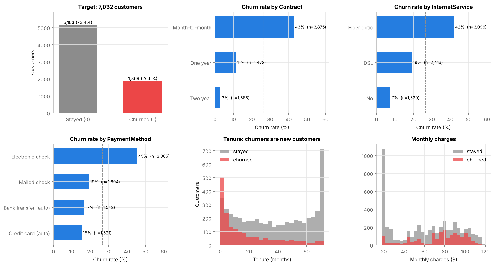

*Figure 1. Real data. Month-to-month contracts (43% churn vs 3% for two-year contracts), fibre-optic internet (42%), electronic-check payment (45%) and short tenure (median 10 months for churners vs 38 for stayers) are strongly associated with churn.*

## 5. Methodology

### 5.1 Pipeline

```
CSV → clean (drop 11 blank TotalCharges, Churn→{0,1}, drop customerID)
    → label-encode 15 categorical columns (19 features)
    → stratified 80/20 split
    → z-score (fit on train) → PCA ≥ 95% (fit on train; 16 components)
    → {majority, base-rate prior, logistic regression, random forest, Bayesian LR (NUTS)}
    → metrics + bootstrap CIs, 5-fold CV, diagnostics, uncertainty analysis, HTML report
```

### 5.2 Preprocessing

`TotalCharges` is stored as text and is blank for the 11 customers with tenure 0. Those rows are removed. Categorical columns are label-encoded with sorted category codes. Features are standardised, $z = (x-\mu)/\sigma$, with $\mu,\sigma$ estimated **on the training split only**. The test set reuses them, which prevents leakage; a unit test checks this.

For the interpretable reference model (§8.3) we also build a one-hot (drop-first) design matrix. Its naive form has 30 columns but only rank 24, because "No internet service" in each of the six add-on columns duplicates `InternetService_No`, and "No phone service" duplicates `PhoneService_No`. Folding those levels into "No" gives **23 full-rank columns**. This cut NUTS sampling time from 168 s (tree depth 7.6) to 54 s (depth 6.1).

### 5.3 Principal component analysis

With $Z \in \mathbb{R}^{n\times d}$ the standardised training data, PCA diagonalises $C = Z^\top Z/(n-1) = V\Lambda V^\top$ and keeps the smallest $k$ with $\sum_{j\le k}\lambda_j / \sum_j \lambda_j \ge 0.95$. This gives **k = 16 components retaining 97.0%** of the variance. The two leading components are interpretable from their loadings. **PC1** is a *loyalty* axis (TotalCharges 0.43, tenure 0.42, Contract 0.32). **PC2** is an *expensive / paperless / senior* axis (MonthlyCharges 0.47, PaperlessBilling 0.38, SeniorCitizen 0.31, Contract −0.31).

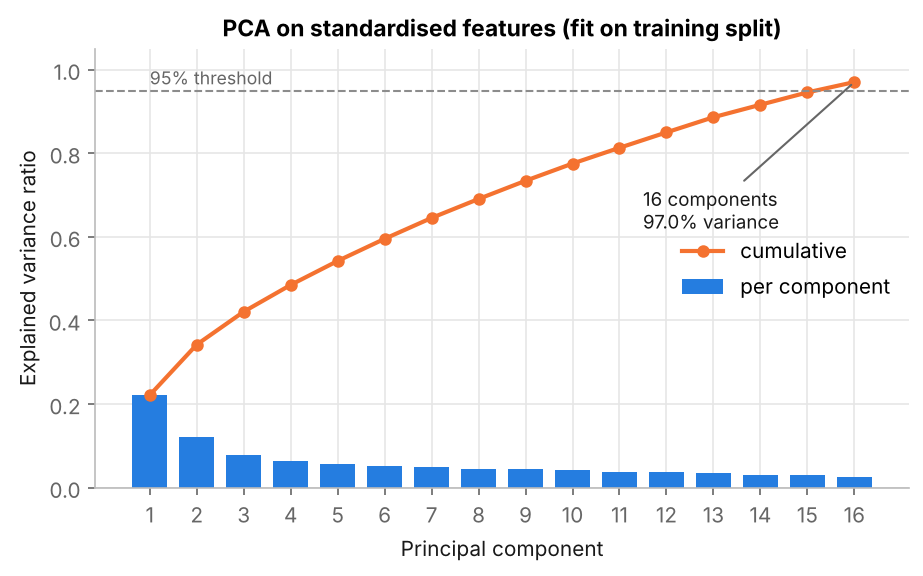

### 5.4 Bayesian logistic regression

$$
\beta_0 \sim \mathcal N(0,1),\qquad \beta_j \sim \mathcal N(0,1)\ (j=1,\dots,16),\qquad
p_i = \sigma\!\Big(\beta_0 + \sum_{j}\beta_j z_{ij}\Big),\qquad y_i \sim \mathrm{Bernoulli}(p_i)
$$

The posterior is $p(\beta\mid D) \propto \prod_i p_i^{y_i}(1-p_i)^{1-y_i}\,\prod_j \mathcal N(\beta_j;0,1)$. Its normalising constant is intractable, so we sample it. The model structure (features → churn) is fixed, so only parameter learning is required. Because the inputs are standardised, N(0, 1) is weakly informative: it allows log-odds effects of about ±2 per SD and is easily dominated by 5,625 observations. Its MAP estimate coincides with L2-penalised logistic regression with $C = 1$.

### 5.5 Hamiltonian Monte Carlo and NUTS

HMC augments the parameters with a momentum $p \sim \mathcal N(0, M)$ and simulates

$$
H(\beta,p) = U(\beta) + K(p),\qquad U(\beta) = -\log p(\beta\mid D),\qquad K(p) = \tfrac12 p^\top M^{-1}p
$$

with the leapfrog integrator ($p \leftarrow p - \tfrac\epsilon2\nabla U$; $\beta \leftarrow \beta + \epsilon M^{-1}p$; $p \leftarrow p - \tfrac\epsilon2\nabla U$). The end point is accepted with probability $\min(1, e^{H_\text{old}-H_\text{new}})$. NUTS (Hoffman & Gelman, 2014) chooses the trajectory length adaptively, stopping when the path starts to double back. Settings: 4 chains, 1,000 tuning + 1,000 retained draws each (4,000 draws), `target_accept = 0.9`, diagonal mass-matrix adaptation, seed 42. The likelihood is written with `logit_p` for numerical stability.

### 5.6 Predictions and uncertainty

For a customer with components $z_*$, every posterior draw gives $p_*^{(s)} = \sigma(\beta_0^{(s)} + \beta^{(s)\top}z_*)$. We report the posterior mean (used for all classification metrics, threshold 0.5), the posterior SD and the **94% highest-density interval** (the shortest interval containing 94% of the draws). These describe *epistemic* uncertainty about $p_*$. The outcome itself remains Bernoulli($p_*$).

### 5.7 Baselines

Majority class (always "stay"); base-rate prior (always $p = 0.266$); scikit-learn logistic regression (L2, $C=1$); random forest (300 trees). All use the same split and the same fitted scaler/PCA. As references we also train LR and RF on the 19 standardised features without PCA, and a Bayesian LR (same priors, NUTS) on the 23 one-hot features.

### 5.8 Evaluation protocol

- **Hold-out test set** (1,407 customers): accuracy, precision, recall, F1 (threshold 0.5), ROC-AUC, PR-AUC, Brier score, log-loss, expected calibration error (ECE, 10 bins).
- **Paired bootstrap** (1,000 resamples of the test set, same indices for every model): 95% CIs and AUC differences.
- **Stratified 5-fold CV** on all 7,032 customers, with scaler, PCA and every model re-fitted inside each fold.
- **MCMC diagnostics**: rank-normalised split R-hat, bulk/tail ESS, divergences, E-BFMI, trace, rank, energy and forest plots.
- **Posterior predictive check** of the churn rate; **prior sensitivity** (σ ∈ {0.01, 0.1, 1, 10}); **PSIS-LOO** model comparison; **training-set-size** study; **synthetic recovery** check.

## 6. Implementation

| Component | File |
|---|---|
| Download (resume, retries, validation) | `scripts/download_data.py` |
| Cleaning, label / one-hot encoding, synthetic generator | `src/data.py` |
| Split, scaler + PCA (fit on train) | `src/features.py` |
| Baselines, HDI, `BayesianLogisticRegression` (PyMC NUTS) | `src/models.py` |
| Metrics, ECE, paired bootstrap | `src/evaluate.py` |
| Figures / HTML report | `src/plots.py`, `src/report.py` |
| End-to-end pipeline | `src/main.py` |
| CV, prior sensitivity + LOO, data size, synthetic check | `scripts/run_*.py` |
| Everything | `scripts/run_all_experiments.sh` |
| Tests (16) | `tests/test_pipeline.py` |

Software: Python 3.13, PyMC 5.28.5, PyTensor 2.38.3, ArviZ 0.23.4, scikit-learn 1.9.1, NumPy 2.4.6, pandas 3.0.5. Hardware: 4 CPU cores, no GPU. The main pipeline runs in about 2 minutes. Re-running it reproduces every metric exactly (fixed seeds).

## 7. Convergence diagnostics

| Diagnostic | Target | PCA model | One-hot model |
|---|---|---|---|
| max R-hat | < 1.01 | **1.003** | 1.004 |
| min bulk ESS (of 4,000) | > 400 | **3,400** | 770 |
| min tail ESS | > 400 | **2,412** | 1,258 |
| divergences | 0 | **0** | 0 |
| min E-BFMI | > 0.3 | **0.98** | 0.95 |
| mean tree depth / step size | n/a | 3.0 / 0.48 | 6.1 / 0.061 |
| sampling time | n/a | 7 s | 54 s |

All checks pass with large margins. The PCA posterior is nearly uncorrelated (Figure 5), which is why NUTS needs only about 8 leapfrog steps per draw. The one-hot posterior has strong correlations (MonthlyCharges is almost a linear combination of the service indicators), so it needs longer trajectories, but it still converges.

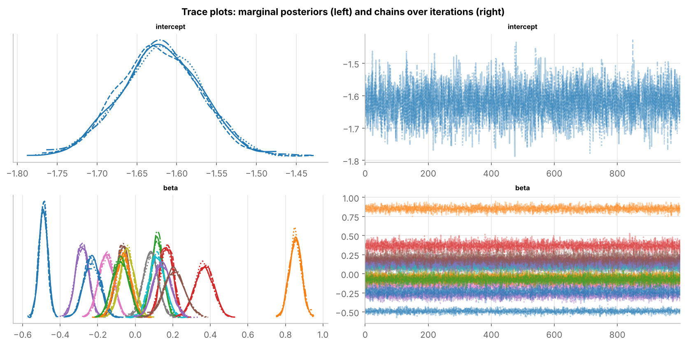

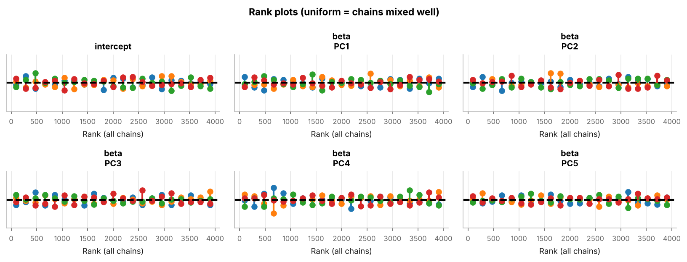

| 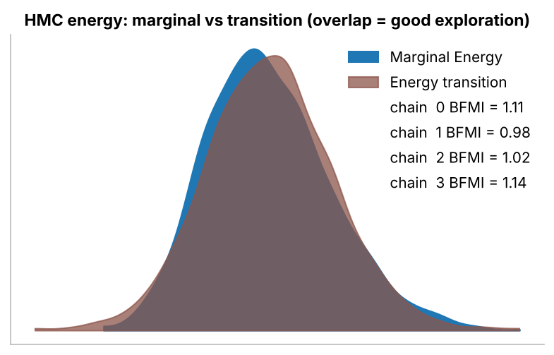 | 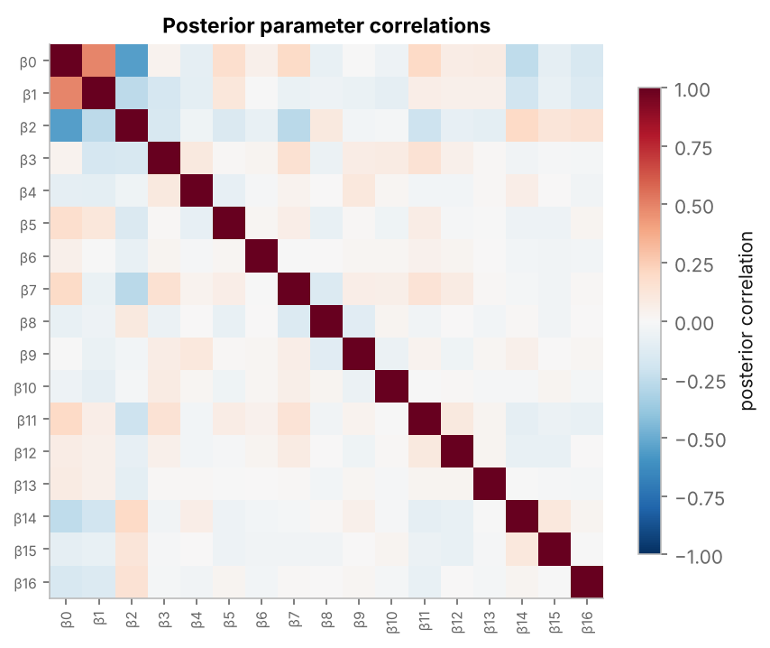 |
|---|---|

*Figure 5. Left: energy plot (marginal and transition energy overlap). Right: posterior correlations between coefficients.*

**Posterior predictive check.** The 94% interval of the churn rate simulated from the posterior is [0.253, 0.279] on the training data (observed 0.266) and [0.252, 0.294] on the test data (observed 0.266).

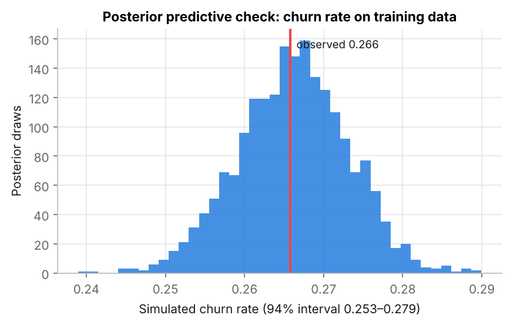

## 8. Results

### 8.1 Hold-out test set (1,407 customers, real data)

| Model | Accuracy | Precision | Recall | F1 | ROC-AUC | PR-AUC | Brier | ECE |
|---|---|---|---|---|---|---|---|---|
| Majority class | 0.7342 | 0.0000 | 0.0000 | 0.0000 | 0.5000 | 0.2658 | 0.2658 | 0.2658 |
| Prior (base rate) | 0.7342 | 0.0000 | 0.0000 | 0.0000 | 0.5000 | 0.2658 | 0.1952 | 0.0000 |
| Logistic Regression (PCA) | 0.7733 | 0.5868 | 0.4973 | 0.5384 | 0.8206 | 0.5876 | 0.1464 | 0.0177 |
| Random Forest (PCA) | 0.7697 | 0.5822 | 0.4733 | 0.5221 | 0.7986 | 0.5604 | 0.1570 | 0.0517 |
| **Bayesian LR, HMC (PCA)** | **0.7733** | **0.5868** | **0.4973** | **0.5384** | **0.8206** | **0.5875** | **0.1463** | **0.0159** |
| Logistic Regression (all features, no PCA) | 0.7939 | 0.6243 | 0.5642 | 0.5927 | 0.8345 | 0.6202 | 0.1410 | 0.0227 |
| Random Forest (all features, no PCA) | 0.7861 | 0.6229 | 0.4947 | 0.5514 | 0.8153 | 0.6008 | 0.1486 | 0.0356 |
| **Bayesian LR, HMC (one-hot, no PCA)** | **0.8038** | **0.6476** | **0.5749** | **0.6091** | **0.8356** | **0.6217** | **0.1402** | **0.0251** |

95% bootstrap CIs for ROC-AUC: Bayesian (PCA) [0.798, 0.843]; LR [0.798, 0.843]; RF [0.773, 0.822]; Bayesian (one-hot) [0.813, 0.857]. Paired AUC differences relative to the Bayesian PCA model: LR +0.0000 [−0.0001, +0.0001]; RF **−0.022** [−0.037, −0.008]; LR without PCA **+0.014** [+0.007, +0.021]; Bayesian one-hot **+0.015** [+0.008, +0.023]. Accuracy CI of the Bayesian model: [0.752, 0.795], entirely above the majority baseline of 0.734.

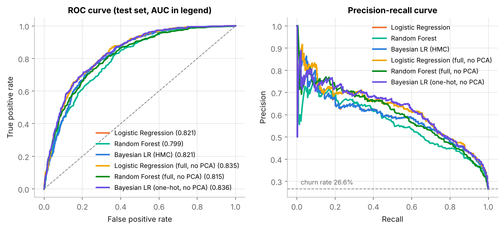

*Figure 7. The LR curve (orange) lies exactly under the Bayesian curve (blue).*

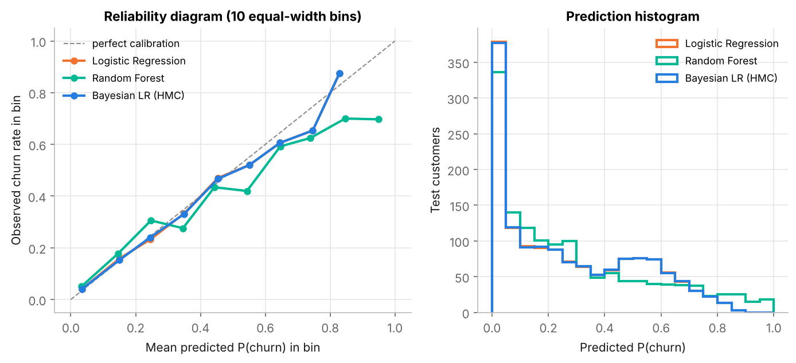

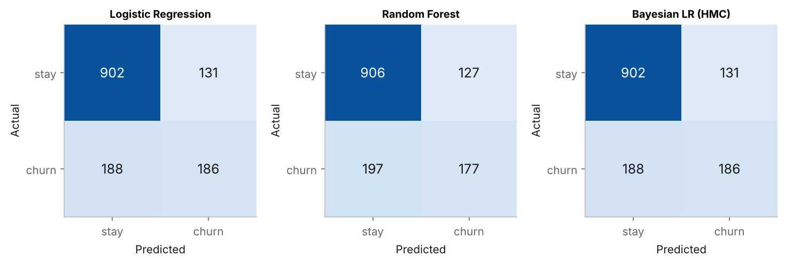

### 8.2 Five-fold cross-validation (all 7,032 customers)

| Model | Accuracy | Precision | Recall | F1 | ROC-AUC | Brier | ECE |
|---|---|---|---|---|---|---|---|
| Logistic Regression (PCA) | 0.7952 ± 0.0086 | 0.6424 ± 0.0222 | 0.5185 ± 0.0150 | 0.5737 ± 0.0166 | 0.8343 ± 0.0033 | 0.1400 ± 0.0016 | 0.0213 ± 0.0081 |
| Random Forest (PCA) | 0.7770 ± 0.0098 | 0.6145 ± 0.0303 | 0.4355 ± 0.0214 | 0.5093 ± 0.0189 | 0.7983 ± 0.0062 | 0.1548 ± 0.0037 | 0.0386 ± 0.0042 |
| **Bayesian LR, HMC (PCA)** | **0.7955 ± 0.0085** | **0.6431 ± 0.0221** | **0.5190 ± 0.0140** | **0.5743 ± 0.0161** | **0.8343 ± 0.0032** | **0.1400 ± 0.0016** | **0.0214 ± 0.0084** |
| Logistic Regression (no PCA) | 0.8016 ± 0.0073 | 0.6500 ± 0.0200 | 0.5506 ± 0.0070 | 0.5961 ± 0.0112 | 0.8443 ± 0.0015 | 0.1361 ± 0.0010 | 0.0201 ± 0.0089 |
| Random Forest (no PCA) | 0.7927 ± 0.0076 | 0.6425 ± 0.0233 | 0.4976 ± 0.0079 | 0.5607 ± 0.0105 | 0.8262 ± 0.0042 | 0.1431 ± 0.0020 | 0.0349 ± 0.0030 |
| **Bayesian LR, HMC (one-hot, no PCA)** | **0.8046 ± 0.0065** | **0.6577 ± 0.0165** | **0.5527 ± 0.0097** | **0.6006 ± 0.0120** | **0.8451 ± 0.0030** | **0.1356 ± 0.0010** | **0.0215 ± 0.0119** |

The fixed 80/20 test split is slightly harder than an average fold (Bayesian AUC 0.821 vs CV mean 0.834). The model ranking is the same in both.

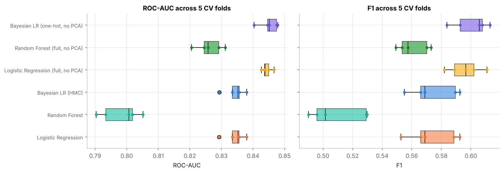

### 8.3 Learned posterior and interpretation

PCA model (first six parameters of 17; all are in `results/main/posterior_summary.csv`):

| Parameter | Mean | SD | 94% HDI | R-hat | Bulk ESS |
|---|---|---|---|---|---|
| Intercept β₀ | −1.6207 | 0.0502 | [−1.716, −1.529] | 1.00 | ≥ 3,400 |
| PC1 β₁ (loyalty) | −0.4896 | 0.0228 | [−0.532, −0.447] | 1.00 | |
| PC2 β₂ (expensive / paperless / senior) | 0.8528 | 0.0318 | [0.794, 0.911] | 1.00 | |
| PC3 β₃ | 0.1173 | 0.0330 | [0.054, 0.179] | 1.00 | |
| PC4 β₄ | 0.1678 | 0.0341 | [0.107, 0.234] | 1.00 | |
| PC5 β₅ | −0.2829 | 0.0344 | [−0.345, −0.217] | 1.00 | |

The posterior means agree with scikit-learn's L2 logistic regression to within 0.004 (about a tenth of a posterior SD; `results/main/coefficients_bayes_vs_lr.csv`), as theory predicts. The small remaining gap comes from sklearn not penalising the intercept and from mean vs mode. The intercept −1.62 corresponds to P(churn) = 0.165 for an "average" customer (all components 0).

**One-hot Bayesian model (interpretable).** Coefficients are log-odds per SD of the standardised feature; 94% HDI in brackets:

| Lowers churn | | Raises churn | |
|---|---|---|---|
| tenure | −1.35 [−1.67, −1.05] | InternetService = Fiber optic | +0.71 [+0.21, +1.26] |
| Contract = Two year | −0.60 [−0.76, −0.45] | TotalCharges | +0.64 [+0.32, +0.97] |
| InternetService = No | −0.60 [−1.02, −0.14] | StreamingTV / StreamingMovies | +0.24 / +0.23 |
| Contract = One year | −0.31 [−0.41, −0.22] | MultipleLines | +0.21 [+0.08, +0.34] |
| OnlineSecurity | −0.14 [−0.26, −0.01] | PaymentMethod = Electronic check | +0.19 [+0.09, +0.28] |
| Dependents | −0.11 [−0.19, −0.02] | PaperlessBilling | +0.14 [+0.06, +0.22] |

`MonthlyCharges` has a very wide interval (−0.79 [−1.99, +0.55]) because it is almost a linear combination of the service indicators. The posterior correctly reports that the data cannot separate these effects. Gender, partner status, phone service and online backup have HDIs that include zero.

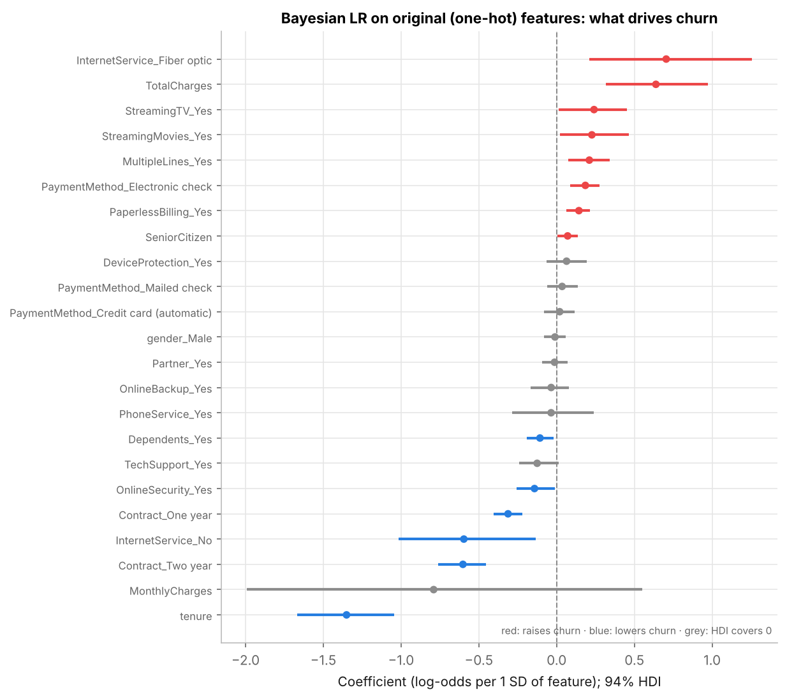

### 8.4 Results reported in the original project, and their reproduction

**Results reported in the original project** (copied from the original README; *not* produced by this rebuild):

| Model | Accuracy | Precision | Recall | F1 | ROC-AUC |
|---|---|---|---|---|---|
| Logistic Regression | 0.7939 | 0.6265 | 0.5561 | 0.5892 | 0.8342 |
| Random Forest | 0.7854 | 0.6216 | 0.4920 | 0.5493 | 0.8238 |
| Bayesian HMC | 0.7704 | 0.5794 | 0.4973 | 0.5353 | 0.8204 |

The original setup was stated as 7,032 customers, "20 features", PCA 20 → 17 components with 97.2% variance. Original posterior: β₀ −1.6266 ± 0.0502, PC1 −0.4907 ± 0.0229, PC2 0.8556 ± 0.0322, PC3 0.1181, PC4 0.1733, PC5 −0.2820.

**Finding.** The cleaned data has 19 features, not 20. The original configuration is reproduced exactly when `customerID` is left in the data and label-encoded as a feature (`python src/main.py --legacy-keep-id`):

| | Original README | Rebuild, legacy (customerID kept) | Rebuild, corrected |
|---|---|---|---|
| Features → PCA components (variance) | 20 → 17 (97.2%) | 20 → 17 (97.2%) | 19 → 16 (97.0%) |
| Bayesian accuracy / precision / recall | 0.7704 / 0.5794 / 0.4973 | 0.7711 / 0.5812 / 0.4973 | 0.7733 / 0.5868 / 0.4973 |
| Bayesian F1 / ROC-AUC | 0.5353 / 0.8204 | 0.5360 / 0.8204 | 0.5384 / 0.8206 |
| Intercept β₀ | −1.6266 ± 0.0502 | −1.6213 ± 0.0498 | −1.6207 ± 0.0502 |
| PC1 / PC2 / PC5 | −0.4907 / 0.8556 / −0.2820 | −0.4893 / 0.8529 / −0.2830 | −0.4896 / 0.8528 / −0.2829 |
| Random Forest ROC-AUC | 0.8238 | 0.8144 | 0.7986 |

The remaining tiny differences (third decimal) are consistent with MCMC noise and different library versions. Two further observations:

- The original **"Logistic Regression" row (AUC 0.8342, accuracy 0.7939)** matches LR on all features **without PCA** (rebuild: 0.8345 / 0.7939), not LR on the PCA components (0.8206). The original table therefore probably compared a non-PCA LR with a PCA-based Bayesian model. That explains why LR looked better than the Bayesian model there. Like for like, the two are identical.
- The original Random Forest numbers did not reproduce exactly (0.8238 vs 0.8144 in the legacy setting). Tree ensembles depend on library version and settings, and the original code and environment were lost.

An identifier carries no information about churn, so the corrected pipeline drops it. The impact on accuracy is negligible (AUC 0.8204 → 0.8206).

### 8.5 Prior sensitivity and LOO model comparison

| Features | Prior σ | ROC-AUC | Log-loss | F1 | elpd_loo ± SE | p_loo | Mean HDI width |
|---|---|---|---|---|---|---|---|
| PCA (16) | 0.01 | 0.8100 | 0.6242 | 0.5871 | −3490.3 ± 7.9 | 1.9 | 0.036 |
| PCA (16) | 0.1 | 0.8204 | 0.4457 | 0.5577 | −2421.6 ± 34.6 | 13.2 | 0.076 |
| PCA (16) | **1** | **0.8206** | **0.4422** | 0.5384 | **−2394.5 ± 40.9** | 17.1 | 0.077 |
| PCA (16) | 10 | 0.8205 | 0.4422 | 0.5384 | −2394.6 ± 40.9 | 17.2 | 0.076 |
| One-hot (23) | 1 | 0.8356 | 0.4278 | 0.6091 | −2338.5 ± 41.4 | 23.7 | 0.088 |

Conclusions hold for any prior from σ = 0.1 to σ = 10. Only an unreasonably tight prior (σ = 0.01) hurts. σ = 0.1 raises F1 at threshold 0.5 slightly, because it pulls probabilities towards the base rate, but it worsens log-loss and elpd. In a **paired** PSIS-LOO comparison (`az.compare`), the one-hot model beats the PCA model by **Δelpd = 56.1 ± 10.9**, more than 5 standard errors.

### 8.6 Uncertainty analysis and the value of the prior

On the 1,407 test customers the 94% HDI of P(churn) has mean width **0.077** (≈ ±3.8 points), median 0.084, 90th percentile 0.135 and maximum 0.195. Intervals are widest for customers with mid-range probabilities (Figure 13). For 13.4% of customers the HDI straddles 0.5.

| Subset of test customers | Accuracy |
|---|---|
| Most confident half (by \|mean − 0.5\| / sd) | **92.2%** |
| Least confident half | 62.4% |
| HDI clear of 0.5 | 81.7% |
| HDI straddles 0.5 | 48.9% (coin flip) |

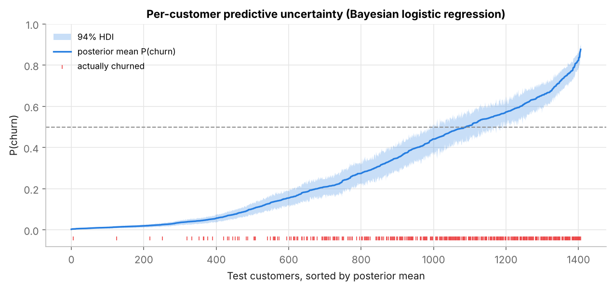

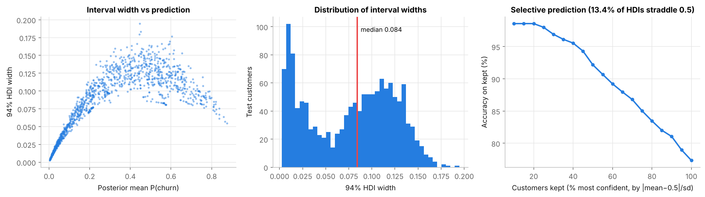

**Training-set size.** We sub-sampled the training split (3 stratified repeats per size) and compared the Bayesian model with essentially unregularised logistic regression (C = 10⁴, ≈ MLE), always on the same 1,407 test customers:

| Train customers | Bayes AUC | ≈MLE AUC | Bayes log-loss | ≈MLE log-loss | Mean HDI width |
|---|---|---|---|---|---|
| 50 | **0.763** | 0.691 | **0.550** | 4.611 | 0.527 |
| 100 | **0.778** | 0.769 | **0.525** | 0.631 | 0.430 |
| 250 | 0.807 | 0.806 | 0.463 | 0.469 | 0.321 |
| 500 | 0.813 | 0.812 | 0.455 | 0.457 | 0.241 |
| 1,000 | 0.817 | 0.817 | 0.448 | 0.449 | 0.175 |
| 2,500 | 0.820 | 0.820 | 0.443 | 0.443 | 0.114 |
| 5,625 | 0.821 | 0.821 | 0.442 | 0.442 | 0.077 |

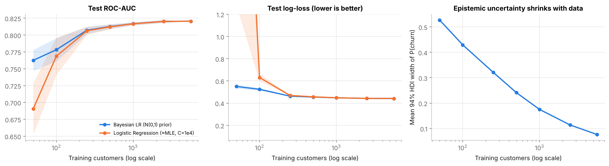

With 50 customers, maximum likelihood over-fits badly (log-loss up to 6.7 in two of three repeats, from confidently wrong probabilities). The N(0, 1) prior keeps the Bayesian model well behaved, and its interval widths (0.53) honestly signal how little it knows. From about 500 customers on the two models coincide, and from there the interval width shrinks roughly as $1/\sqrt n$ (0.241 → 0.077 for an 11× larger sample; √11.25 ≈ 3.4).

### 8.7 Synthetic sanity check (SYNTHETIC data, not real customers)

To check that the sampler and the HDI code are implemented correctly, we generated 10 synthetic datasets (n = 2,000, d = 8 correlated features) from a logistic model with **known** coefficients and fitted the same Bayesian model. The 94% HDIs contained the true coefficient in **94.4%** of the 90 cases (target 94%). The mean RMSE of the posterior means was 0.079. Test AUC was 0.872 vs 0.873 for the true model. Max R-hat was 1.003, with 0 divergences.

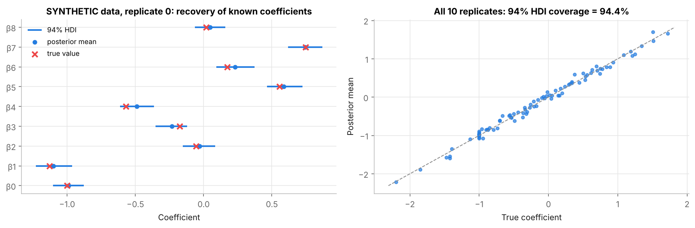

## 9. Discussion

**The Bayesian model is accurate, but no more accurate than its classical twin.** On real data it is far above chance (CV AUC 0.834 vs 0.5; accuracy 79.6% vs 73.4% for the trivial baseline) and well calibrated. With N(0, 1) priors on standardised inputs, the posterior mean coincides with L2-regularised logistic regression (coefficients within 0.004); with 5,625 observations the prior barely moves it. Claims that the Bayesian model is *more accurate* would not be supported by these results, and we do not make them.

**Its added value is calibrated uncertainty and robustness.** The credible intervals separate reliable predictions (92% accuracy) from doubtful ones (62%; 49% when the HDI straddles 0.5). Much of this signal comes from the distance of the mean from 0.5, which any probabilistic classifier has. The Bayesian posterior adds a principled width on top of it. That width matters most with little data: with 50–100 customers the prior prevents catastrophic over-fitting, and the intervals widen to show how little is known.

**PCA was not beneficial for accuracy.** It decorrelates the inputs (fast, well-conditioned sampling) but discards the directions that matter for churn and makes coefficients harder to interpret. The same Bayesian model on one-hot features is significantly better (paired AUC gain +0.015 [+0.008, +0.023]; Δelpd 56 ± 11) and directly interpretable. It confirms the EDA: short tenure, month-to-month contracts, fibre-optic internet, electronic-check payment and paperless billing increase churn.

**Random forest** was the weakest non-trivial model here and the least calibrated (ECE 0.05 on the test set). Relationships in this dataset are close to additive in log-odds, so a linear model suits them well.

**Reproducing the original numbers** exposed two issues in the original analysis: `customerID` was used as a feature, and the LR row came from a different feature set than the Bayesian row. Neither changes the qualitative conclusions, but both are corrected here.

## 10. Limitations

- One public dataset from a single (fictional) operator, at one point in time. There are no event dates, so time-to-churn modelling is not possible.
- A threshold of 0.5 is not cost-optimal for a 27% base rate. A real deployment should choose the threshold, or the targeting rule, from incentive costs and customer value.
- Label encoding imposes an arbitrary order on nominal categories before PCA (kept to follow the original design).
- Posterior intervals describe parameter uncertainty *within* the assumed linear-logistic model. They do not cover model misspecification or future distribution shift.
- The original code and environment were lost, so the original results are reproduced approximately (to 2–3 decimals), not bit-for-bit.

## 11. Conclusion

We rebuilt a complete, reproducible Bayesian churn-prediction pipeline on the real IBM Telco data. A Bayesian logistic regression on 16 PCA components, sampled with NUTS, converges cleanly. It predicts churn with CV ROC-AUC 0.834 (accuracy 79.6% vs a 73.4% baseline), matches L2 logistic regression, beats a random forest, and attaches a well-behaved 94% credible interval to every prediction. These intervals identify unreliable predictions and protect against over-fitting when data is scarce. The best model overall is the same Bayesian regression on interpretable one-hot features (CV AUC 0.845).

## 12. Future Work

- Hierarchical priors (partial pooling by contract or region) and sparsity-inducing priors (horseshoe) for feature selection.
- Bayesian decision analysis: choose incentive recipients by maximising posterior expected profit.
- Non-linear Bayesian classifiers (BART, Gaussian-process classification, Bayesian neural networks), compared via LOO.
- Survival models with tenure as time-to-event, if dated churn records become available.
- Variational inference (ADVI / Pathfinder) for very large customer bases, validated against NUTS.

## References

1. IBM. *Telco Customer Churn* sample dataset. Kaggle: `blastchar/telco-customer-churn`.
2. C. M. Bishop. *Pattern Recognition and Machine Learning*. Springer, 2006.
3. K. P. Murphy. *Machine Learning: A Probabilistic Perspective*. MIT Press, 2012.
4. R. M. Neal. "MCMC Using Hamiltonian Dynamics." In *Handbook of Markov Chain Monte Carlo*, CRC Press, 2011.
5. D. Koller & N. Friedman. *Probabilistic Graphical Models*. MIT Press, 2009.
6. M. D. Hoffman & A. Gelman. "The No-U-Turn Sampler." *JMLR* 15:1593–1623, 2014.
7. A. Gelman et al. *Bayesian Data Analysis*, 3rd ed. CRC Press, 2013.
8. A. Vehtari, A. Gelman, D. Simpson, B. Carpenter, P.-C. Bürkner. "Rank-normalization, folding, and localization: an improved R-hat." *Bayesian Analysis* 16(2), 2021.
9. A. Vehtari, A. Gelman, J. Gabry. "Practical Bayesian model evaluation using leave-one-out cross-validation and WAIC." *Statistics and Computing* 27, 2017.
10. M. Betancourt. "A Conceptual Introduction to Hamiltonian Monte Carlo." arXiv:1701.02434, 2017.
11. O. Abril-Pla et al. "PyMC: a modern and comprehensive probabilistic programming framework in Python." *PeerJ Computer Science* 9:e1516, 2023.
12. R. Kumar et al. "ArviZ: a unified library for exploratory analysis of Bayesian models." *JOSS* 4(33), 2019.
